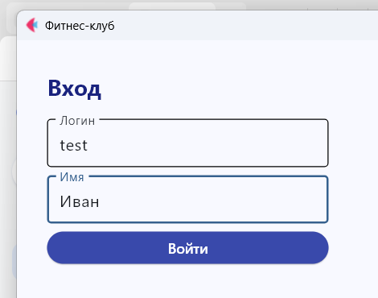
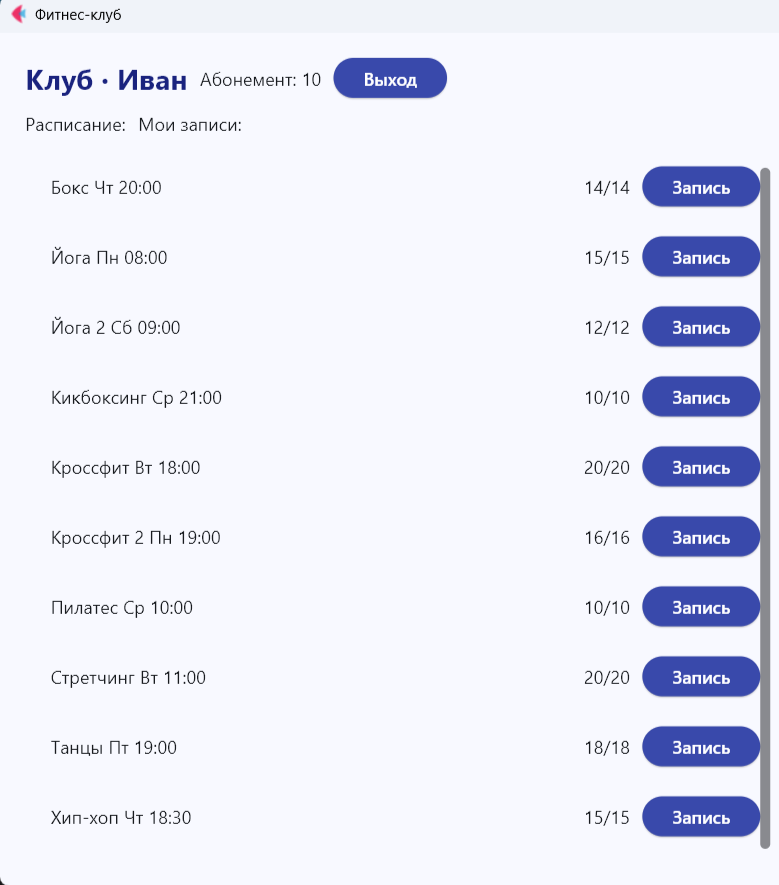
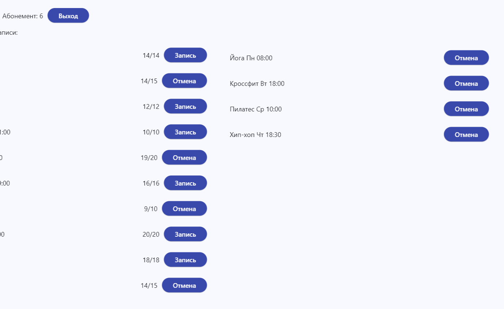
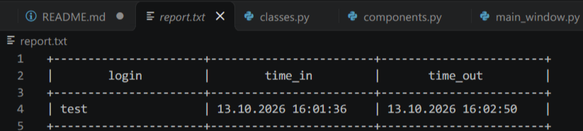

# Фитнес-клуб

Приложение по ООП, 2 курс. Python + Flet.

## Файлы проекта

    main.py           запуск
    main_window.py    окно и логика
    classes.py        классы Training, Client, MyMap, Base
    components.py     свои UI-компоненты

## Как запустить

    pip install -r requirements.txt
    python main.py

## Что умеет

- вход по логину и имени
- абонемент на 10 занятий
- расписание из 10 тренировок
- запись и отмена, лимит 4 активных
- отчёт report.txt при выходе
## Скриншоты

### Вход

### Главное окно

### Запись на тренировку

### Отчёт

## Про ООП

- абстрактный класс Base
- классы Training и Client наследуются от него
- замена словаря - свой класс MyMap
- 10 переопределённых UI-компонентов
- магические методы, геттеры и сеттеры